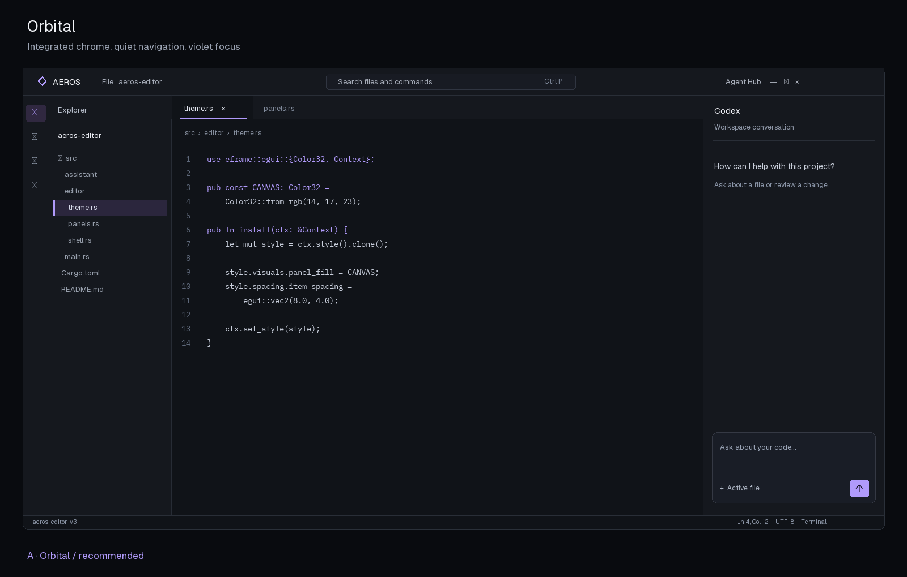
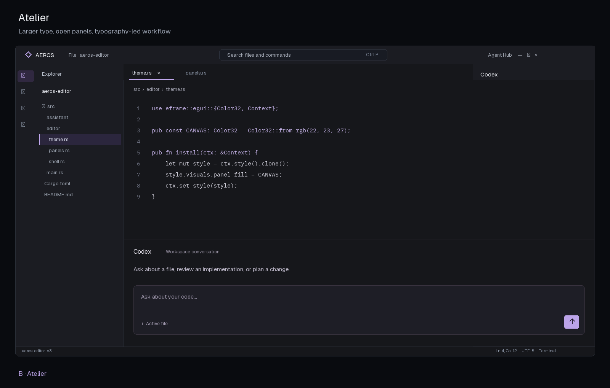
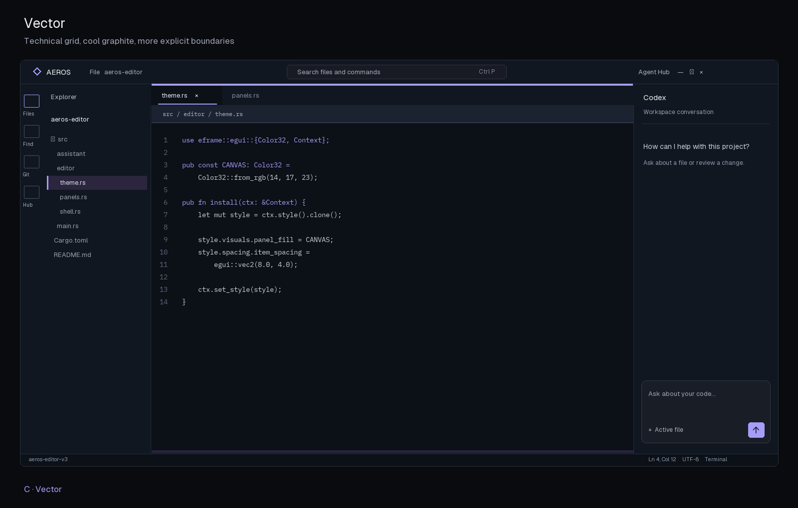

# AEROS V3 — Orbital

## Propósito y alcance

AEROS es un editor nativo para una persona que alterna entre navegar un repositorio, escribir código y consultar a Codex durante sesiones largas. La interfaz debe orientar esas acciones con poco ruido, conservar espacio de código y mantener la misma jerarquía en todas las superficies. V3 se concentra en presentación y ergonomía de las funciones de V2.

El dominio visual combina documentos, rutas, cursores, ramas, comandos, órbitas y puntos de enfoque. El grafito del área de código, el carbón de las herramientas y el violeta de foco forman la identidad. La firma es una órbita abierta alrededor del símbolo de AEROS, repetida con moderación en Home, el acceso a agentes y la selección de navegación.

## Auditoría verificada

El punto de partida es `298ecfa`, con eframe/egui 0.33.3, backend OpenGL glow, syntect y rfd. El código de edición, archivos y proveedores funciona independientemente de la capa visual.

Las tres capturas suministradas muestran Home, Quick Access y un archivo Rust. Se identificaron doble altura de chrome, botones con el mismo peso visual para todas las acciones, contornos excesivos, árbol muy espaciado, pestañas tipo chip, paleta con resultados de anchura irregular, sintaxis de contraste desigual y un compositor con acciones separadas por espacio vacío.

## Tres direcciones antes de implementar

Estas imágenes son propuestas de composición. Las capturas de validación se producen después desde una ventana nativa.

| Dirección | Composición | Identidad | Legibilidad | Ergonomía IDE | Coherencia | Factibilidad egui | Rendimiento esperado |
| --- | --- | --- | --- | --- | --- | --- | --- |
| Orbital | Chrome integrado, rail fino, editor central y conversación lateral | 9/10 | 9/10 | 9/10 | 9/10 | 9/10 | Favorable, primitivas y color |
| Atelier | Texto mayor y conversación horizontal bajo el editor | 8/10 | 9/10 | 7/10 | 9/10 | 9/10 | Favorable, ocupa más altura |
| Vector | Navegación rotulada y límites más marcados alrededor del documento | 8/10 | 8/10 | 8/10 | 8/10 | 9/10 | Favorable, más trazos visibles |

Las puntuaciones son una evaluación de diseño. El rendimiento se medirá sobre la implementación.

### Selección

Orbital conserva el patrón de trabajo de V2, reduce la competencia entre herramientas y facilita usar el archivo junto a Codex. Atelier consume altura útil de código en 1366×768. Vector resulta más exigente visualmente en sesiones largas. La elección se apoya en la proporción del editor y la lectura periférica de navegación, conversación y estado.

## Skills evaluadas

Se leyeron los SKILL.md y los archivos de licencia de los cinco repositorios. Se usan criterios pertinentes como referencia de diseño. La implementación es Rust original del proyecto.

| Fuente | Licencia observada | Compatibilidad | Aplicación en AEROS |
| --- | --- | --- | --- |
| pbakaus/impeccable | Apache-2.0 | Criterios de crítica transferibles. Su launcher y las herramientas web no son dependencias del editor | Jerarquía, moderación y revisión de capturas |
| ryktara/design-engineering-skill | MIT | Incluye escritorio, sin guía específica de egui | Auditar el producto antes de la forma y validar tamaños, foco y densidad |
| Dammyjay93/interface-design | MIT | Los principios de herramientas y tokens son aplicables a egui | Un foco por pantalla, capas sutiles y controles coherentes |
| nextlevelbuilder/ui-ux-pro-max-skill | MIT | Predomina la implementación web y móvil | Contraste y estados. Las pautas táctiles se adaptan al puntero de escritorio |
| anthropics/skills/frontend-design | Apache-2.0 | Orientación visual general y ejemplos web | Tipografía intencional, composición y crítica de patrones repetidos |

Los scripts y launchers de esos repositorios quedan fuera del flujo de ejecución. Sus instrucciones de instalación y sus supuestos web se evaluaron frente al alcance nativo autorizado.

Fuentes oficiales [Impeccable](https://github.com/pbakaus/impeccable), [Design Engineering](https://github.com/ryktara/design-engineering-skill), [Interface Design](https://github.com/Dammyjay93/interface-design), [UI UX Pro Max](https://github.com/nextlevelbuilder/ui-ux-pro-max-skill) y [Frontend Design](https://github.com/anthropics/skills/tree/main/skills/frontend-design).

## Sistema visual

### Color semántico

El área de edición usa grafito `#101318`. Las herramientas usan carbón `#15181E`. Los controles elevados usan `#1D222B` y los resultados seleccionados `#29263C`. El texto principal es `#E5E9F0`, el secundario `#A2ACBA` y la metadata `#8793A4`. El violeta `#B09AFA` comunica foco y selección. Verde, ámbar y rojo quedan reservados para estado semántico.

Las constantes de color y la configuración de widgets viven en `src/editor/theme.rs`. Los contrastes se comprobaron mediante cálculo sobre los colores reales.

### Tipografía

Geist para interfaz, títulos y mensajes. IBM Plex Mono para código y terminal. Ambas se incrustan en el ejecutable. Sus licencias SIL Open Font License se incluyen en [Geist-OFL.txt](assets/fonts/Geist-OFL.txt) e [IBMPlexMono-OFL.txt](assets/fonts/IBMPlexMono-OFL.txt). Escala de interfaz de 12, 13, 15, 20, 28 y 40 puntos lógicos. El tamaño del editor conserva su ajuste independiente. La altura de línea usa 1,4 veces el tamaño de código y 1,25 en modo compacto.

### Ritmo y geometría

Base espacial de 4 puntos. Controles normales de 28 puntos y filas de 28 puntos, con variante compacta de 24. Rail de 48 puntos. Barra superior de 44. Pestañas de 36 y breadcrumb de 28. Los paneles se distinguen por superficie y un único separador compartido. Radios de 2 para checkboxes, 4 para filas, 6 para controles, 10 para compositor y 12 para ventanas y modales.

### Interacción y movimiento

Los elementos activos combinan tono de fondo y una marca violeta. Hover usa un cambio tonal de 100 ms con salida suave. El foco de teclado conserva un contorno visible. Los elementos deshabilitados reducen contraste dentro de la capa de controles. La paleta responde inmediatamente y permite recorrer resultados con las flechas y confirmar con Enter.

La opción de movimiento reducido elimina transiciones. El arte de Home es estático para evitar repintados en reposo. Las transiciones se desactivan al perder foco.

### HiDPI y accesibilidad

Las medidas se expresan en puntos lógicos de egui y se escalan a píxeles físicos. Los iconos se dibujan mediante trazos coherentes y se acompañan de etiquetas accesibles y tooltips. El modo de alto contraste refuerza bordes y foco. La validación incluye renderizado nativo a 1920×1080 y 1366×768, y escala de interfaz 125 % y 150 %. La matriz usa el escalado de egui dentro de ventanas nativas para probar layout y rasterización a esas densidades.

## Intención por superficie

| Superficie | Foco | Tratamiento |
| --- | --- | --- |
| Chrome | Proyecto y comandos | Una franja, búsqueda central y controles de ventana legibles |
| Quick Access | Resultado seleccionado | Filas completas, búsqueda amplia y ayuda de teclado al pie |
| Explorer | Ruta activa | Filas compactas, iconos de archivo y marca lateral |
| Editor | Código | Tabs continuas, gutter tenue, breadcrumb y sintaxis equilibrada |
| Codex | Conversación y escritura | Mensajes con roles claros y compositor unido |
| Home | Abrir o retomar trabajo | Composición abierta, acciones en filas y recientes con ruta |
| Agent Hub | Conversación o tarea seleccionada | Navegación estable, proveedores como lista |
| Settings y diálogos | Decisión actual | Agrupación, labels persistentes y acciones alineadas |
| Terminal y estado | Salida y estado útil | Franja de herramientas compacta y texto monoespaciado |

## Validación y mediciones

### Defectos visuales corregidos

- Chrome duplicado y jerarquía plana en la barra superior. Se integraron proyecto, Quick Access y controles de ventana en 44 puntos.
- Pestañas tipo chip y cierre separado. Se creó una franja continua con selección subrayada, estado modificado y cierre contextual.
- Explorador con filas de peso y espaciado inconsistentes. Se alinearon títulos, rutas, iconos y controles.
- Resultados de Quick Access como botones sueltos. Se usan filas completas, selección visible y navegación con flechas y Enter.
- Compositor de Codex fragmentado. Entrada, contexto y envío comparten una superficie, con Enviar alineado a la derecha.
- Encabezados y subtítulos de Home alineados en una sola fila. Se corrigió el layout vertical y la composición para ventanas estrechas.
- Títulos y campos de Settings excesivamente altos en 150 %. Se añadió un límite de altura, scroll interno y una región segura.
- Panel de IA demasiado ancho en ventanas estrechas. Su ancho máximo se adapta para mantener al código como área principal.
- Checkboxes excesivamente redondos, similares a botones de opción. Se aplicó un radio propio de 2 puntos a los controles nativos.
- Tipografía y sintaxis con contraste desigual. Se incorporaron fuentes locales y colores de sintaxis coordinados.
- Navegación de Agent Hub repartida en botones superiores. Se reorganizó en una navegación lateral estable.

### Contrastes calculados

| Uso | Contraste |
| --- | --- |
| Texto principal sobre canvas | 15,28:1 |
| Texto secundario sobre herramientas | 7,74:1 |
| Metadata sobre herramientas | 5,71:1 |
| Violeta sobre selección | 6,16:1 |
| Cadenas de código | 10,59:1 |

Estos pares superan 4,5:1. La prueba de tokens comprueba el umbral. La evaluación completa de accesibilidad también requiere probar lectores de pantalla.

### Capturas reproducibles

Las capturas proceden del framebuffer OpenGL de ventanas nativas mediante `ViewportCommand::Screenshot`. El test abre un workspace temporal con archivos reales. La conversación utiliza mensajes de ejemplo para comparar composición y desbordamiento de forma reproducible. La integración autenticada de Codex se comprueba en una prueba independiente.

La matriz cubre Home, editor, conversación, Quick Access, Agent Hub, tareas, memoria, skills, Settings, diálogo de archivo, terminal y Git.

| Resolución física | Escala de interfaz | Capturas finales |
| --- | --- | --- |
| 1366×768 | 100 %, 125 %, 150 % | 36 |
| 1920×1080 | 100 %, 125 %, 150 % | 36 |
| V2 de referencia | 1366×768 y 1920×1080, 100 % | 24 |

Los PNG se validan por sus dimensiones físicas. El 125 % y 150 % se aplican mediante el escalado de egui dentro de ventanas reales. Esto permite probar layout y rasterización con esas densidades.

| Vista | V2 | V3 |
| --- | --- | --- |
| Home | [1366×768](design/captures/before/1366x768-100/home.png) | [1366×768](design/captures/after/1366x768-100/home.png) |
| Editor | [1366×768](design/captures/before/1366x768-100/editor.png) | [1366×768](design/captures/after/1366x768-100/editor.png) |
| Quick Access | [1366×768](design/captures/before/1366x768-100/quick-access.png) | [1366×768](design/captures/after/1366x768-100/quick-access.png) |
| Agent Hub | [1920×1080](design/captures/before/1920x1080-100/agent-hub.png) | [1920×1080](design/captures/after/1920x1080-100/agent-hub.png) |
| Settings | [1366×768](design/captures/before/1366x768-100/settings.png) | [1366×768 a 150 %](design/captures/after/1366x768-150/settings.png) |

El test de captura se ejecuta definiendo `AEROS_REVIEW_DIR`, `AEROS_REVIEW_WIDTH`, `AEROS_REVIEW_HEIGHT` y `AEROS_REVIEW_SCALE`, y ejecutando `cargo test --locked capture_design_review -- --ignored`. Las capturas de V2 se obtuvieron antes de editar su sistema visual.

### Rendimiento medido

| Escenario | Arranque V2 / V3 | RAM V2 / V3 | Memoria privada V2 / V3 | CPU en reposo V2 / V3 |
| --- | --- | --- | --- | --- |
| Home | 320,88 / 314,05 ms | 82,17 / 81,96 MiB | 93,79 / 93,09 MiB | 0 / 0 % |
| Workspace | 309,86 / 316,12 ms | 82,56 / 82,52 MiB | 93,78 / 93,24 MiB | 0 / 0 % |

Las diferencias de arranque son pequeñas y varían entre escenarios; no demuestran una mejora de velocidad. El consumo de memoria permanece al nivel de V2. El 0 % de CPU corresponde a la ventana de muestreo, no a una garantía de consumo nulo. El ejecutable pasa de 12.246.016 a 12.630.016 bytes, principalmente por las fuentes incrustadas. [Resultados y hashes](design/performance-windows.json).

El script reproducible es `design/benchmark_windows.py`. Recibe las rutas del ejecutable V2, ejecutable V3, proyecto y carpeta de configuración de prueba. Ejecuta calentamiento y tres muestras intercaladas por escenario. Arranque significa tiempo hasta `WaitForInputIdle`. RAM es working set del proceso y CPU se muestrea durante 1,3 s después de estabilizarlo. Los resultados corresponden a este equipo.

### Regresiones

| Comprobación | Resultado |
| --- | --- |
| Pruebas locales de regresión | 12 aprobadas |
| Prueba autenticada de Codex | Aprobada, archivo adjunto y dos turnos con contexto |
| Captura nativa | 6 configuraciones aprobadas, 12 vistas por configuración |
| Dimensiones de PNG | 96 archivos verificados |
| Clippy con warnings como errores | Aprobado |
| Release Windows x64 | Generado |
| cargo check Linux x64 | Aprobado |
| cargo check macOS Apple Silicon | Aprobado |

Las pruebas locales incluyen apertura, guardado, cambios externos, pestañas, búsqueda, protección de cambios sin guardar, procesos de consola, configuración, contraste y navegación por teclado de Quick Access. Las pruebas de agentes y de ventanas nativas conservan su selección explícita mediante `--ignored`. La prueba de Codex de dos turnos se ejecutó en esta validación.

### Limitaciones de validación

El escalado se verificó en la interfaz de egui. El cambio global del DPI de Windows y el movimiento entre monitores requieren una comprobación manual adicional. Los diálogos de abrir archivos y carpetas pertenecen al sistema operativo. La navegación por lector de pantalla y el comportamiento de Snap al pasar por maximizar requieren validación manual.

El arte de Home es estático. Las transiciones de hover se desactivan con movimiento reducido o pérdida de foco. Los indicadores de actividad también pasan a una figura estática en esas condiciones. La implementación se concentra en los módulos de presentación y las preferencias visuales.

## Tradeoffs del framework

egui permite este diseño con fuentes incrustadas, primitivas vectoriales, temas y layout nativo. El chrome integrado requiere implementar arrastre, minimizar, maximizar y cierre mediante ViewportCommand. Las funciones de ventanas y el comportamiento de Windows se verificarán donde el entorno lo permita. La accesibilidad completa para lectores de pantalla requiere una evaluación adicional del backend.
