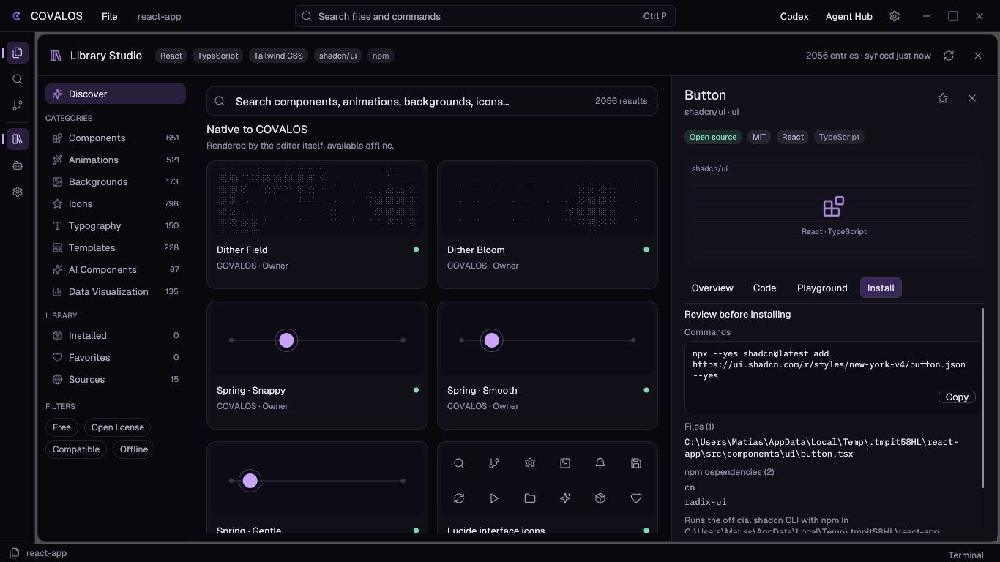

<p align="center">
  
</p>

<h1 align="center">COVALOS</h1>

<p align="center">
  <strong>IDE nativo en Rust con diseño futurista minimalista y orquestación multiagente.</strong><br/>
  Velocidad nativa, control total del desarrollador y estética <em>Nocturne</em> — sin Electron.
</p>

<p align="center">
  
  
  
  
</p>

---

## Qué buscamos

**COVALOS** nace con un objetivo concreto: construir un **IDE nativo de escritorio en Rust** que combine la ergonomía, precisión y disciplina visual de **IntelliJ IDEA**, **Zed**, **Linear** y **Raycast** con la potencia multiagente de **Cursor**, **Kiro** y **Google Antigravity**.

El nombre viene de *enlace covalente*: distintos núcleos compartiendo un mismo campo para formar una estructura estable — la misma idea detrás de un entorno donde el desarrollador y múltiples agentes de IA colaboran sobre un workspace compartido, con supervisión explícita y control total sobre cada cambio.

**Principios del proyecto:**
- **Rendimiento nativo real:** binario único compilado en Rust (`covalos.exe`), sin runtime web ni consumo excesivo de memoria.
- **Futurismo minimalista premium:** tema oscuro *Nocturne*, superficies redondeadas en islas, jerarquía tipográfica clara y animaciones con resortes amortiguados (nunca estética gamer ni sobrecarga visual).
- **Control del desarrollador primero:** los agentes proponen, planifican y revisan; los cambios de código y las instalaciones de paquetes requieren aprobación explícita, con respaldo y reversión reales.

---

## Capturas reales de COVALOS

> Todas las imágenes provienen de ejecuciones reales de la compilación Release (`covalos.exe`) sobre OpenGL.

| Pantalla de inicio · *Nocturne + Dither Field* | Editor Rust · *Sintaxis Nocturne* |
| :---: | :---: |
|  |  |

| Clean Code · *Editores flotantes sobre el mismo buffer* | Library Studio · *Catálogo offline + plan verificable* |
| :---: | :---: |
|  |  |

---

## Qué ya tenemos

### 1. Editor nativo y flujo diario
- **Explorador y pestañas:** apertura de carpetas/archivos, creación, renombrado, movimiento y borrado seguro con confirmación, proyectos recientes y breadcrumbs.
- **Edición confiable:** archivos UTF-8 (hasta 1 MiB), preservación de BOM y saltos CRLF/LF, detección de cambios externos antes de sobrescribir y búsqueda en archivo (`Ctrl+F`, `F3` / `Shift+F3`) y en todo el workspace (`Ctrl+Shift+F`, respetando reglas de ignore).
- **Resaltado de sintaxis semántico:** gramáticas `syntect` combinadas con clasificación semántica propia y paletas independientes del tema (*Nocturne*, *Graphite*, *Daylight*, *High Contrast*).
- **Quick Access (`Ctrl+P`):** búsqueda unificada de archivos, comandos (`>`), proyectos recientes (`@`) y consultas a Codex (`?`).
- **Git integrado:** detección de rama, cambios agrupados por estado (*staged*, *working tree*, *untracked*, conflictos) y visualización de diffs directamente en el área del editor.
- **Panel de herramientas:** ejecutor de comandos desde la raíz del proyecto, salida en vivo con cancelación y registro de actividad de agentes.

### 2. Nocturne Design System y movimiento
- **Superficies en islas:** paneles redondeados separados sobre lienzo oscuro `#09080D` con bordes finos de 1 px y jerarquía clara.
- **Dither Field y Dither Bloom:** fondo nativo en GLSL de dos pasadas (ruido de valor fbm → tramado ordenado Bayer 8×8 → píxeles cuadrados con estela del cursor y ondas al clic). Se pausa sin foco o con *Reduce Motion*; en estado estacionario consume ~2,1 % de CPU total y ~6 % de GPU en AMD Ryzen 5 5600G + Radeon integrada (0,0 % con fondo desactivado).
- **Motor de springs (`src/editor/motion.rs`):** animaciones interrumpibles con tres presets cercanos al amortiguamiento crítico (*Snappy*, *Smooth*, *Gentle*), intensidad configurable y soporte completo de *Reduce Motion*.
- **Personalización e idioma:** 6 temas (*COVALOS Nocturne*, *Graphite*, *Midnight*, *Violet*, *Light*, *High Contrast*), tamaño de fuente, densidad compacta/cómoda, vista previa en vivo y soporte completo en **Español** e **Inglés**.

### 3. Clean Code (ventanas flotantes)
- Permite desprender cualquier pestaña a una ventana flotante sin duplicar memoria ni estado: comparte exactamente el mismo `Document` (buffer, dirty state, guardado, resaltado y guardas de salida).
- Admite múltiples editores flotantes simultáneos, modo enfoque y acople animado de vuelta a la barra de pestañas.

### 4. Library Studio
- **Catálogo local-first:** 10 registros oficiales sincronizables por ETag incremental (más de **2.050 componentes reales** en 3–4 s), 5 fuentes de solo enlace y 7 recursos nativos de COVALOS con playground en vivo disponibles sin conexión.
- **Respeto estricto de licencias:** fuentes permisivas (MIT/ISC) pueden cachear código; fuentes sin redistribución (Commons Clause / Aceternity) almacenan solo metadatos; fuentes comerciales muestran enlace únicamente.
- **Compatibilidad honesta e instalación real con reversión:** detecta framework y gestor de paquetes (`npm`, `pnpm`, `yarn`, `bun`), muestra los comandos exactos, archivos y conflictos antes de ejecutar, respalda manifiestos y archivos conflictivos, y permite **revertir cambios** restaurando el estado previo.
- **API estructurada para agentes (`--library`):** comandos CLI con salida JSON y separación explícita entre datos de terceros e instrucciones.

### 5. Agent Hub y Companion Luma
- **Conversaciones en workspace y aisladas:** integración funcional con **Codex** y **Claude Code** (descubrimiento preparado para **Gemini CLI** y **Antigravity**), adjuntado acotado del archivo activo y persistencia de conversaciones por workspace con recuperación tras cierre inesperado.
- **Flujos Ask / Assist / Auto:** planificación, revisión, previsualización de parches con aprobación explícita y memoria local del proyecto + importación revisada de `SKILL.md` desde GitHub.
- **Puente de hooks (`--agent-hook`) y mascota Luma:** supervisión en vivo de estados de agentes y aprobaciones acotadas, reflejados visualmente por Luma (arte vectorial nativo en `egui`).

### 6. Identidad nativa y migración segura
- **Empaquetado Windows nativo:** `build.rs` embebe el ícono `.ico` multicapa (16–256 px) y los metadatos PE (`COVALOS`, versión `0.4.0.0`) directamente en `covalos.exe` sin depender de herramientas externas.
- **Migración no destructiva desde AEROS:** detecta perfiles previos en `AerosEditor` y los migra una sola vez hacia `Covalos` sin sobrescribir archivos existentes ni borrar los datos anteriores.

---

## Qué usamos (Stack técnico y activos)

### Núcleo Rust
| Componente | Crate / Tecnología | Uso en COVALOS |
| --- | --- | --- |
| Lenguaje | **Rust (Edition 2024)** | Binario nativo de alto rendimiento, seguridad de memoria y compilación con LTO thin |
| UI y Renderer | **`eframe` + `egui` 0.33.3 (`glow`)** | Interfaz nativa acelerada por OpenGL, ventanas flotantes y shaders GLSL personalizados |
| Sintaxis | **`syntect` 5.3 + `egui_extras`** | Gramáticas Sublime y clasificación semántica propia por paleta |
| Archivos y búsqueda | **`ignore`**, **`regex`**, **`rfd`**, **`tempfile`** | Indexado rápido respetando `.gitignore`, diálogos nativos del SO y escrituras atómicas |
| Datos e imágenes | **`serde`**, **`serde_json`**, **`png`** | Preferencias, catálogo offline, estado persistente y texturas RGBA8 con mipmaps |
| Integración SO | **`windows-sys` 0.61**, **`libc`** | Idioma del sistema, sistema de archivos y ejecución limpia de subprocesos |

### Tipografía, iconografía y marcas de terceros
- **Tipografía:** *Geist* (interfaz) e *IBM Plex Mono* (código), ambas bajo licencia **SIL OFL** (`assets/fonts/`).
- **Iconos de interfaz:** *Lucide 0.460.0* (**ISC**), 71 iconos rasterizados como máscaras con mipmaps (`assets/icons/ui/`).
- **Iconos de archivos y carpetas:** *Material Icon Theme 5.40.0* (**MIT**), 116 iconos (`assets/icons/material/`).
- **Marcas de proveedores:** documentadas con términos y procedencia en [`assets/brands/PROVENANCE.md`](assets/brands/PROVENANCE.md).
- **Isotipo de COVALOS (provisional):** diseño centralizado en [`assets/brand/`](assets/brand/PROVENANCE.md) regenerable desde un único SVG maestro mediante [`tools/generate_brand_assets.py`](tools/generate_brand_assets.py).

---

## Compilación y ejecución

### Requisitos
- Rust estable (`rustup` / `cargo`)
- En Windows: OpenGL 3.3+ (soportado por GPUs integradas AMD/Intel y dedicadas)
- Opcional: `git`, `node`/`npm` (para instalar componentes web desde Library Studio) y `codex` / `claude` CLI para Agent Hub.

### Comandos principales (PowerShell)

```powershell
# Formateo, análisis estático estricto y suite de pruebas
cargo fmt --check
cargo clippy --all-targets -- -D warnings
cargo test

# Compilación Release (genera target/release/covalos.exe)
cargo build --release

# Ejecutar abriendo un proyecto directamente
.\target\release\covalos.exe C:\ruta\a\tu\proyecto
```

### CLI de Library Studio para agentes

```powershell
covalos.exe --library search "animated button" --project C:\ruta\al\proyecto --compatible --limit 10
covalos.exe --library show shadcn/button --project C:\ruta\al\proyecto
covalos.exe --library compat shadcn/button --project C:\ruta\al\proyecto
covalos.exe --library plan shadcn/button --project C:\ruta\al\proyecto
covalos.exe --library sources
covalos.exe --library sync [source]
covalos.exe --library installed
```

### Configuración y variables de entorno

| Ruta / Variable | Descripción |
| --- | --- |
| `%LOCALAPPDATA%\Covalos` | Perfil predeterminado en Windows (`~/Library/Application Support/Covalos` en macOS, `~/.config/covalos` en Linux) |
| `COVALOS_CONFIG_DIR` | Sobrescribe el directorio de configuración (acepta `AEROS_CONFIG_DIR` como respaldo) |
| `COVALOS_CODEX_BIN` / `COVALOS_CLAUDE_BIN` | Ruta absoluta opcional al binario del agente (`COVALOS_GEMINI_BIN`, `COVALOS_AGY_BIN` también soportadas) |

---

## Atajos de teclado

| Atajo | Acción |
| --- | --- |
| `Ctrl / Cmd + P` | Quick Access (archivos, `>` comandos, `@` proyectos, `?` Codex) |
| `Ctrl / Cmd + Shift + L` | Abrir / cerrar Library Studio *(configurable en Settings)* |
| `Ctrl / Cmd + O` | Abrir carpeta |
| `Ctrl / Cmd + Shift + O` | Abrir archivo |
| `Ctrl / Cmd + N` | Nuevo archivo |
| `Ctrl / Cmd + S` | Guardar archivo activo |
| `Ctrl / Cmd + W` | Cerrar pestaña activa |
| `Ctrl / Cmd + F` | Buscar en el archivo (`F3` / `Shift+F3` siguiente/anterior) |
| `Ctrl / Cmd + Shift + F` | Buscar en todo el workspace |
| `` Ctrl / Cmd + ` `` | Mostrar / ocultar panel inferior y terminal |

---

## Roadmap — Hacia dónde vamos

- [ ] **Aprobación del isotipo definitivo** de COVALOS y paquete de instalador para Windows.
- [ ] **Orquestación multiagente completa:** adaptadores headless verificados para **Gemini CLI** y **Antigravity (`agy`)**, memoria compartida entre agentes e inyección del CLI de Library Studio desde Agent Hub.
- [ ] **Vista previa web aislada (WebView2)** en proceso separado para componentes React en Library Studio.
- [ ] **IDE avanzado:** integración LSP (autocompletado, diagnósticos, formateo y navegación), depuración (DAP), terminal persistente con PTY real y soporte de extensiones.
- [ ] **Pausa inmediata al minimizar ventanas sin bordes en Windows** mediante detección nativa `IsIconic`.

---

## Documentación adicional

- [`docs/CHECKPOINT.md`](docs/CHECKPOINT.md) — Estado actual, métricas de benchmark, verificación E2E y próximos pasos.
- [`docs/DESIGN_SYSTEM.md`](docs/DESIGN_SYSTEM.md) — Especificación del sistema visual Nocturne, paleta y shaders.
- [`assets/brand/PROVENANCE.md`](assets/brand/PROVENANCE.md) — Estado provisional del isotipo y guía de reemplazo en un paso.
- [`assets/brands/PROVENANCE.md`](assets/brands/PROVENANCE.md) — Licencias y términos de marcas de proveedores.
