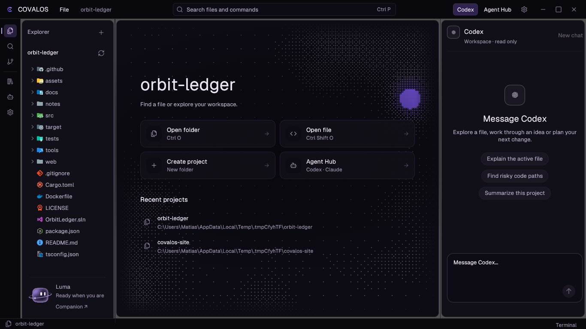

<p align="center">
  
</p>

<h1 align="center">COVALOS</h1>

<p align="center">
  <strong>A native Rust IDE built for speed, craft, and multi-agent development.</strong><br/>
  Nocturne design system, GPU Dither Field, Clean Code floating editors, Library Studio, and full developer control — with zero Electron overhead.
</p>

<p align="center">
  
  
  
  
</p>

---

## Vision

**COVALOS** is a native desktop IDE written in Rust that brings together the speed, ergonomics, and visual discipline of **IntelliJ IDEA**, **Zed**, **Linear**, and **Raycast** with the multi-agent workflows of **Cursor**, **Kiro**, and **Google Antigravity**.

The name comes from *covalent* — distinct nuclei sharing a common field to form a stable structure. That is the core model of COVALOS: the developer and multiple AI agents operating over a shared workspace with explicit supervision, bounded authority, and zero black-box surprises.

**Core principles:**
- **True native performance:** Single compiled Rust binary (`covalos.exe`) rendered on OpenGL — no bundled browser runtime.
- **Minimalist futuristic craft:** The *Nocturne* dark design system — rounded island surfaces, crisp 1 px borders, disciplined typography, and critically damped spring motion (never noisy, gamer, or bloated).
- **Developer control first:** Agents plan, review, and propose edits; code modifications and package installations require explicit user approval, backed by real snapshots and rollback.

---

## Real Captures

> Every screenshot below is captured directly from a real Windows Release build (`covalos.exe`) running on OpenGL.

| Home · *Nocturne + Dither Field* | Rust Editor · *Nocturne Syntax* |
| :---: | :---: |
|  |  |

| Clean Code · *Floating editors sharing the live buffer* | Library Studio · *Offline-first catalog + install review* |
| :---: | :---: |
|  |  |

---

## What Is Built

### 1. Native Editor & Daily Workflow
- **Explorer & tabs:** Open folders and files, create/rename/move/delete with confirmation guards, recent workspaces, and breadcrumbs.
- **Reliable file handling:** UTF-8 files up to 1 MiB, BOM and CRLF/LF preservation, external-change detection before overwriting, in-file find (`Ctrl+F`, `F3` / `Shift+F3`), and ignore-aware workspace search (`Ctrl+Shift+F`).
- **Semantic syntax highlighting:** `syntect` grammars paired with a semantic token classifier and independent code color schemes (*Nocturne*, *Graphite*, *Daylight*, *High Contrast*).
- **Quick Access (`Ctrl+P`):** Unified modal for workspace files, editor commands (`>`), recent projects (`@`), and Codex queries (`?`).
- **Integrated Git:** Branch detection, status grouped by state (*staged*, *working tree*, *untracked*, *conflicts*), and inline diffs in the editor area.
- **Bottom tools panel:** Workspace command runner with live output and cancellation, editor log, and agent activity stream.

### 2. Nocturne Design System & Motion
- **Island architecture:** Rounded panels floating over a deep `#09080D` canvas with hairline 1 px borders and high-contrast visual hierarchy.
- **Dither Field & Dither Bloom:** Original two-pass GLSL background renderer (value-noise fbm → Bayer 8×8 ordered dithering → square pixel grid with pointer trail and click ripples). Pauses automatically without focus or with *Reduce Motion*. Benchmarked on AMD Ryzen 5 5600G + integrated Radeon Graphics at ~2.1% total CPU (~6% GPU) in steady-state animation and 0.0% CPU/GPU when disabled.
- **Spring motion engine (`src/editor/motion.rs`):** Interruptible critically damped springs (*Snappy*, *Smooth*, *Gentle*), global motion intensity slider, and full *Reduce Motion* support.
- **Customization & localization:** 6 themes (*COVALOS Nocturne*, *Graphite*, *Midnight*, *Violet*, *Light*, *High Contrast*), configurable font size, compact/comfortable density, live syntax preview, and full **English** / **Spanish** localization.

### 3. Clean Code (Floating Editors)
- Detach any open tab into a floating editor window without copying state: every floating surface operates directly on the shared `Document` buffer, dirty flag, save path, and exit guards.
- Supports multiple simultaneous floating editors, focus mode, and spring-animated docking back into the tab strip.

### 4. Library Studio
- **Local-first component catalog:** Incremental ETag sync across 10 official registries (**2,050+ real entries** synced in ~3–4 s), 5 link-only sources, and 7 offline native COVALOS resources with live interactive playgrounds.
- **Strict license compliance:** Permissive (MIT/ISC) sources cache source code locally; non-redistributable sources (Commons Clause / Aceternity) store metadata only and fetch source on demand; commercial libraries show links only.
- **Honest compatibility & verified install/rollback:** Detects project framework and package manager (`npm`, `pnpm`, `yarn`, `bun`), previews exact CLI commands, target files, dependencies, and conflicts before running, backs up manifests and conflicting files, and supports full rollback (verified end-to-end with real `npm` / `npx shadcn@latest`).
- **Structured Agent CLI (`--library`):** JSON output designed for agent workflows with explicit untrusted-data notices.

### 5. Agent Hub & Luma Companion
- **Workspace & isolated agent sessions:** Working adapters for **Codex** and **Claude Code** (with discovery wired for **Gemini CLI** and **Antigravity**), bounded active-file context attachment, and persistent per-workspace conversations with interrupted-session recovery.
- **Ask / Assist / Auto workflows:** Read-only planning and review, single-buffer patch preview with approval, local project memory, and reviewed `SKILL.md` imports from public GitHub repositories.
- **Hook bridge (`--agent-hook`) & Luma:** Live agent status tracking and scoped permission approvals reflected by Luma, an original procedural vector companion rendered natively in `egui`.

### 6. Native Packaging & Safe Migration
- **Windows executable identity:** `build.rs` embeds a multi-resolution `.ico` (16–256 px) and standard Windows PE `VERSIONINFO` (`COVALOS`, `0.4.0.0`) directly into `covalos.exe` with zero external build tools required.
- **Non-destructive migration from AEROS:** Automatically detects legacy `AerosEditor` profiles on first launch, migrates settings, conversations, Library Studio state, and agent-bridge data once without overwriting existing COVALOS files or deleting legacy folders, and maps `aeros/*` native IDs to `covalos/*`.

---

## Tech Stack & Assets

### Core Rust Stack
| Area | Crates / Technology | Role |
| --- | --- | --- |
| Language | **Rust (Edition 2024)** | Native desktop performance, memory safety, thin-LTO release builds |
| UI & Renderer | **`eframe` + `egui` 0.33.3 (`glow`)** | Native OpenGL desktop UI, floating surfaces, custom GLSL shaders |
| Syntax | **`syntect` 5.3 + `egui_extras`** | Sublime grammars + custom semantic token classifier & themes |
| Workspace I/O | **`ignore`**, **`regex`**, **`rfd`**, **`tempfile`** | `.gitignore`-aware indexing, native OS dialogs, atomic file writes |
| Data & Imaging | **`serde`**, **`serde_json`**, **`png`** | Preferences, offline catalog, state persistence, mipmapped RGBA8 textures |
| OS Integration | **`windows-sys` 0.61**, **`libc`** | System locale detection, filesystem APIs, clean subprocess handling |

### Typography, Icons & Third-Party Marks
- **Fonts:** *Geist* (UI) and *IBM Plex Mono* (code), licensed under **SIL OFL** (`assets/fonts/`).
- **UI Icons:** *Lucide 0.460.0* (**ISC**), 71 mipmapped monochrome icon masks (`assets/icons/ui/`).
- **File & Folder Icons:** *Material Icon Theme 5.40.0* (**MIT**), 116 icons (`assets/icons/material/`).
- **Provider Marks:** Documented with full terms and provenance in [`assets/brands/PROVENANCE.md`](assets/brands/PROVENANCE.md).
- **COVALOS Mark (Provisional):** Centralized in [`assets/brand/`](assets/brand/PROVENANCE.md) and regenerated from a single master SVG via [`tools/generate_brand_assets.py`](tools/generate_brand_assets.py).

---

## Building & Running

### Prerequisites
- Stable Rust toolchain (`rustup` / `cargo`)
- OpenGL 3.3+ capable GPU (tested on integrated AMD Radeon Graphics)
- Optional: `git`, `node` / `npm` (for Library Studio React component installs), and `codex` / `claude` CLIs for Agent Hub.

### Build, Lint & Test

```powershell
cargo fmt --check
cargo clippy --all-targets -- -D warnings
cargo test
cargo build --release

# Launch COVALOS directly into a workspace
.\target\release\covalos.exe C:\path\to\your\project
```

### Library Studio CLI (JSON)

```powershell
covalos.exe --library search "animated button" --project C:\path\to\project --compatible --limit 10
covalos.exe --library show shadcn/button --project C:\path\to\project
covalos.exe --library compat shadcn/button --project C:\path\to\project
covalos.exe --library plan shadcn/button --project C:\path\to\project
covalos.exe --library sources
covalos.exe --library sync [source]
covalos.exe --library installed
```

### Configuration & Environment Variables

| Path / Variable | Purpose |
| --- | --- |
| `%LOCALAPPDATA%\Covalos` | Default profile location on Windows (`~/Library/Application Support/Covalos` on macOS, `~/.config/covalos` on Linux) |
| `COVALOS_CONFIG_DIR` | Override configuration directory (falls back to `AEROS_CONFIG_DIR` for compatibility) |
| `COVALOS_CODEX_BIN` / `COVALOS_CLAUDE_BIN` | Optional absolute path override for agent CLIs (`COVALOS_GEMINI_BIN` and `COVALOS_AGY_BIN` supported as well) |

---

## Keyboard Shortcuts

| Shortcut | Action |
| --- | --- |
| `Ctrl / Cmd + P` | Quick Access (files, `>` commands, `@` recent projects, `?` Codex) |
| `Ctrl / Cmd + Shift + L` | Toggle Library Studio *(configurable in Settings)* |
| `Ctrl / Cmd + O` | Open folder |
| `Ctrl / Cmd + Shift + O` | Open file |
| `Ctrl / Cmd + N` | New file |
| `Ctrl / Cmd + S` | Save active file |
| `Ctrl / Cmd + W` | Close active tab |
| `Ctrl / Cmd + F` | Find in active file (`F3` / `Shift + F3` next / previous) |
| `Ctrl / Cmd + Shift + F` | Search workspace |
| `` Ctrl / Cmd + ` `` | Toggle bottom tools & terminal panel |

---

## Roadmap

- [ ] **Final brand isotype sign-off** and Windows installer packaging.
- [ ] **Full multi-agent orchestration:** Verified headless adapters for **Gemini CLI** and **Antigravity (`agy`)**, shared cross-agent memory, and automatic Library Studio CLI guidance inside Agent Hub.
- [ ] **Isolated WebView2 previews** for React components in Library Studio.
- [ ] **Advanced IDE capabilities:** LSP (completion, diagnostics, formatting, go-to-definition), DAP debugging, persistent PTY terminal, and extension support.
- [ ] **Instant minimize pause on borderless Windows frames** using native `IsIconic` state detection.

---

## Documentation

- [`docs/CHECKPOINT.md`](docs/CHECKPOINT.md) — Current build status, benchmark metrics, E2E verification, and next steps.
- [`docs/DESIGN_SYSTEM.md`](docs/DESIGN_SYSTEM.md) — Nocturne design system specification, tokens, and GLSL shaders.
- [`assets/brand/PROVENANCE.md`](assets/brand/PROVENANCE.md) — Provisional brand assets and one-step replacement workflow.
- [`assets/brands/PROVENANCE.md`](assets/brands/PROVENANCE.md) — Third-party provider mark licenses and terms.
