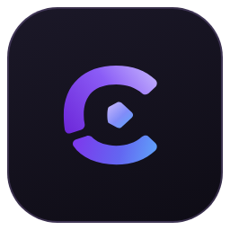
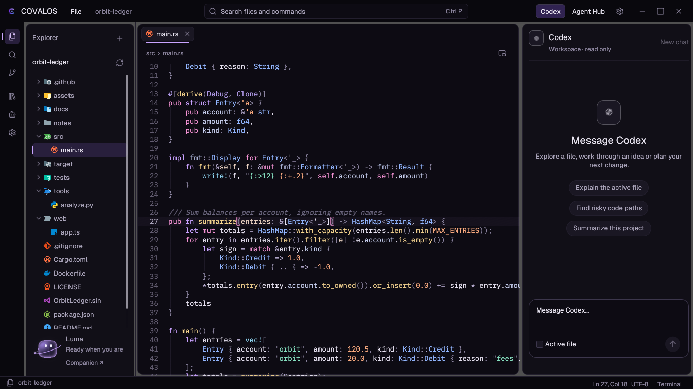
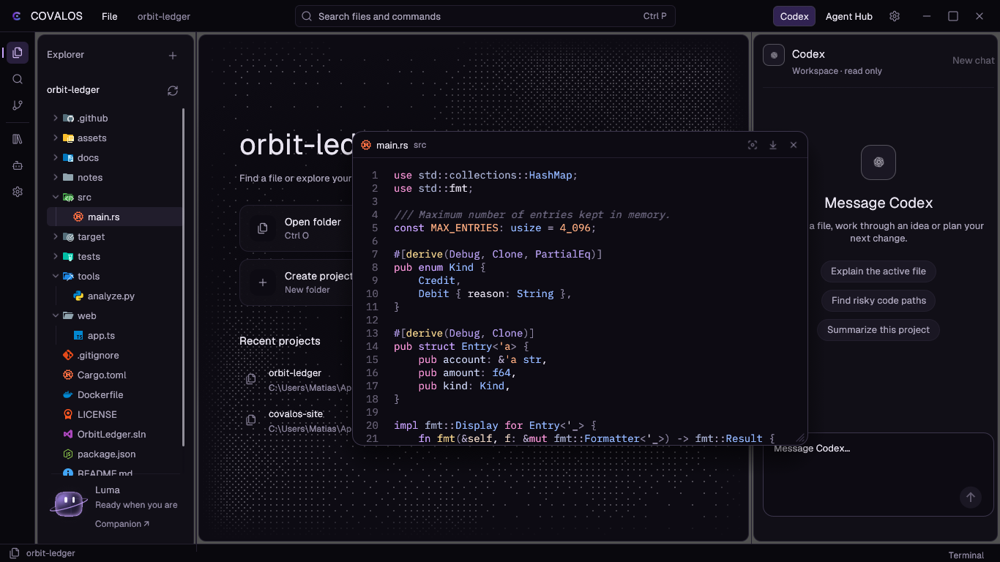

<p align="center">
  
</p>

<h1 align="center">COVALOS</h1>

<p align="center">
  Native desktop code editor written in Rust, with built-in support for running coding agents (Codex, Claude Code) against your workspace.
</p>

<p align="center">
  
  
  
</p>

## Overview

COVALOS is a single Rust binary rendered with `eframe`/`egui` on OpenGL. There is no bundled browser runtime. The editor covers the usual daily workflow (files, search, terminal, Git, LSP) and adds an agent panel that drives the official Codex and Claude Code CLIs. Agents can plan, review and propose edits; writes and package installs require explicit approval.

The project is in beta and currently targets Windows first. Linux and macOS builds compile but get less testing.

## Screenshots

| Home | Rust editor |
| :---: | :---: |
|  |  |

| Floating editors | Library Studio |
| :---: | :---: |
|  |  |

## Features

### Editor

- Explorer with live filter, project switcher, tabs, breadcrumbs and resizable side/bottom panels.
- Session restore: last workspace, open tabs, active file, agent session and Guided Mode progress.
- UTF-8 files up to 1 MiB, BOM and line ending preservation, external change detection before overwrite.
- Find in file (`Ctrl+F`, `F3`/`Shift+F3`) and `.gitignore`-aware workspace search (`Ctrl+Shift+F`).
- LSP client (diagnostics, completion, UTF-16 position mapping) on top of `syntect` highlighting.
- Command palette (`Ctrl+P`) for files, commands and recent projects.
- Back/forward navigation between views, files and conversations (`Alt+Left`/`Alt+Right`, mouse side buttons, or the arrows next to the command field). `Esc` closes the topmost overlay.
- Git: status by state, stage and commit, history, inline diffs, and a GitHub PR/issue tab using `gh`.
- ConPTY terminal on Windows with ANSI rendering and dev server URL detection.
- Settings import (read only) from VS Code, Cursor, Windsurf and Zed.

### Agents

- Agent panel backed by the Codex and Claude Code CLIs, with model and effort selection and `/model`, `/effort` commands.
- Conversations are listed by project in the sidebar. Right click a conversation to pin, archive or delete it.
- Optional git worktree per session, scoped permission approvals through the `--agent-hook` bridge.
- Local agent rules (`agent-rules.md`) and `SKILL.md` import from public GitHub repositories.
- Local usage view (tokens, turns, models).
- One-click npm install for the supported CLIs, restricted to an allowlist.

### Guided Mode

Turns an AI-generated plan into a step-by-step code-along window synced to the editor buffer. Before starting, local imports (TS/JS, Rust, Python) are inspected so steps never reference a file that does not exist yet. Two orderings are available: just-in-time (start in the entry file and branch out when a dependency is needed) and dependencies first. Progress is saved per workspace.

### Floating editors

Any tab can be detached into a floating window. Floating windows share the same document buffer, dirty state and save path as the tab.

### Library Studio

- Local catalog synced with ETags from 10 registries, plus link-only sources and a few built-in components.
- Respects source licenses: permissive sources are cached, non-redistributable ones only store metadata, commercial ones are link-only.
- Detects framework and package manager (`npm`, `pnpm`, `yarn`, `bun`), shows the exact commands and affected files before installing, backs up touched files and supports rollback.
- JSON CLI for scripts and agents (`--library`).

### Other

- Themes, font size, density and English/Spanish UI.
- Optional animated GLSL backgrounds. They pause when the window loses focus or when Reduce Motion is on.
- Optional Discord Rich Presence (off by default). Paths, file names and prompts are never sent.
- First launch migrates settings from the old `AerosEditor` profile without deleting it.

## Building

Requirements: stable Rust, an OpenGL 3.3 GPU. Optional: `git`, `node`/`npm` (Library Studio installs), `codex`/`claude` CLIs (agents).

```powershell
cargo fmt --check
cargo clippy --all-targets -- -D warnings
cargo test
cargo build --release

.\target\release\covalos.exe C:\path\to\project
```

### Windows installer

`.\tools\build-windows-installer.ps1` builds the release binary and packages it with Inno Setup 6. See [`docs/WINDOWS_INSTALLER.md`](docs/WINDOWS_INSTALLER.md).

### Library CLI

```powershell
covalos.exe --library search "animated button" --project C:\path\to\project --compatible --limit 10
covalos.exe --library show shadcn/button --project C:\path\to\project
covalos.exe --library compat shadcn/button --project C:\path\to\project
covalos.exe --library plan shadcn/button --project C:\path\to\project
covalos.exe --library sources
covalos.exe --library sync [source]
covalos.exe --library installed
```

## Configuration

| Path / variable | Purpose |
| --- | --- |
| `%LOCALAPPDATA%\Covalos` | Profile directory on Windows (`~/Library/Application Support/Covalos` on macOS, `~/.config/covalos` on Linux) |
| `COVALOS_CONFIG_DIR` | Overrides the profile directory (`AEROS_CONFIG_DIR` is still read) |
| `COVALOS_CODEX_BIN`, `COVALOS_CLAUDE_BIN` | Absolute path overrides for the agent CLIs (`COVALOS_GEMINI_BIN`, `COVALOS_AGY_BIN` also supported) |

## Keyboard shortcuts

| Shortcut | Action |
| --- | --- |
| `Ctrl+P` | Command palette |
| `Ctrl+Shift+L` | Library Studio (configurable) |
| `Ctrl+O` / `Ctrl+Shift+O` | Open folder / open file |
| `Ctrl+N` | New file |
| `Ctrl+S` | Save |
| `Ctrl+W` | Close tab |
| `Ctrl+F` / `Ctrl+Shift+F` | Find in file / search workspace |
| `` Ctrl+` `` | Toggle terminal panel |
| `Ctrl+Shift+A` | Toggle agent panel |
| `Alt+Left` / `Alt+Right` | Back / forward |
| `Esc` | Close the topmost overlay |

On macOS use `Cmd` instead of `Ctrl`.

## Roadmap

- [ ] Final brand mark.
- [ ] Gemini CLI and Antigravity (`agy`) adapters.
- [ ] Isolated WebView2 previews in Library Studio.
- [ ] DAP debugging, formatting and go-to-definition through LSP.

## Third-party assets

- Fonts: Geist and IBM Plex Mono (SIL OFL), in `assets/fonts/`.
- UI icons: Lucide 0.460.0 (ISC), in `assets/icons/ui/`.
- File icons: Material Icon Theme 5.40.0 (MIT), in `assets/icons/material/`.
- Provider marks: see [`assets/brands/PROVENANCE.md`](assets/brands/PROVENANCE.md).
- COVALOS mark: see [`assets/brand/PROVENANCE.md`](assets/brand/PROVENANCE.md), generated by [`tools/generate_brand_assets.py`](tools/generate_brand_assets.py).

## Documentation

- [`docs/DESIGN_SYSTEM.md`](docs/DESIGN_SYSTEM.md): design tokens and shaders.
- [`docs/RELEASE.md`](docs/RELEASE.md): versioning and release process.
- [`docs/WINDOWS_INSTALLER.md`](docs/WINDOWS_INSTALLER.md): installer build, verification and signing.
